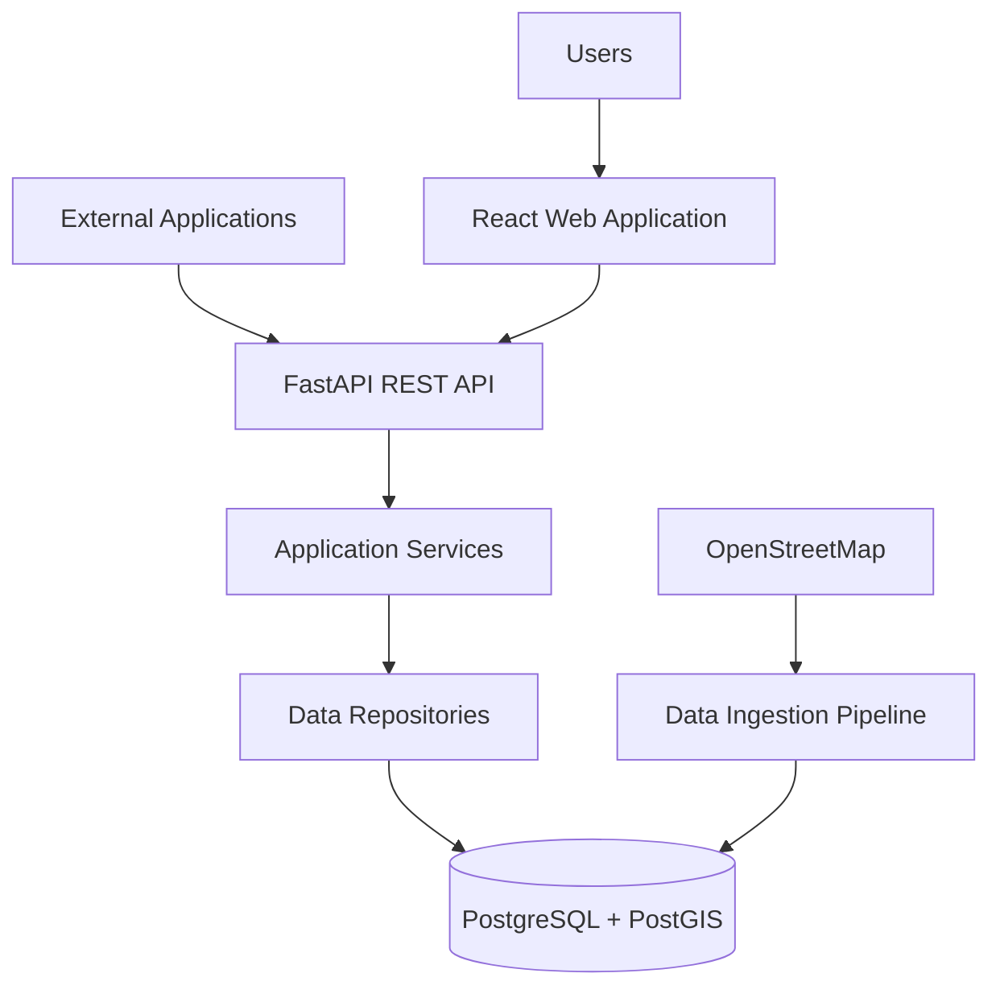

# System Architecture

## 1. Architecture Overview

CamperSpot API adopts a modular monolithic architecture
within a monorepo.

The system consists of:

- A REST API backend.
- A PostgreSQL database with PostGIS.
- A React web application.
- A data ingestion pipeline.
- A containerized development infrastructure.

## 2. High-Level Architecture

## 3. Backend Architecture

The backend follows a layered architecture.

### API Layer

Handles HTTP requests, routing, input validation
and HTTP responses.

### Service Layer

Contains application logic and business rules.

### Repository Layer

Handles database access and persistence operations.

### Model Layer

Defines database entities and relationships.

### Schema Layer

Defines request and response data structures.

## 4. Database Architecture

PostgreSQL provides relational data storage.

PostGIS provides spatial data types, indexes
and geographic queries.

Geographic coordinates will use WGS84 (SRID 4326).

Database schema changes will be managed through Alembic.

## 5. Frontend Architecture

The web application will use React and TypeScript.

Leaflet will provide interactive map functionality.

The frontend will communicate with the backend through
versioned REST API endpoints.

## 6. Data Ingestion

The ingestion pipeline will be responsible for:

1. Extracting data from approved sources.
2. Validating incoming records.
3. Normalizing data into a common format.
4. Detecting duplicate locations.
5. Loading data into PostgreSQL.
6. Recording source information and import metadata.

External data ingestion will be independent of
user-facing API requests.

## 7. Development Infrastructure

Docker Compose will provide reproducible local services.

The backend will initially run in a local Python
virtual environment.

Containerization of the backend will be introduced
during the development process.

## 8. Security Architecture

- Input validation.
- Parameterized database queries.
- Environment-based configuration.
- Restricted database access.
- CORS configuration.
- Rate limiting before public deployment.
- HTTPS in production.
- Controlled write operations.

## 9. Future Scalability

The architecture may be extended with:

- Redis caching.
- Background workers.
- Database replicas.
- Load balancing.
- Independent service deployment where justified.

These components are intentionally excluded
from the initial implementation.
